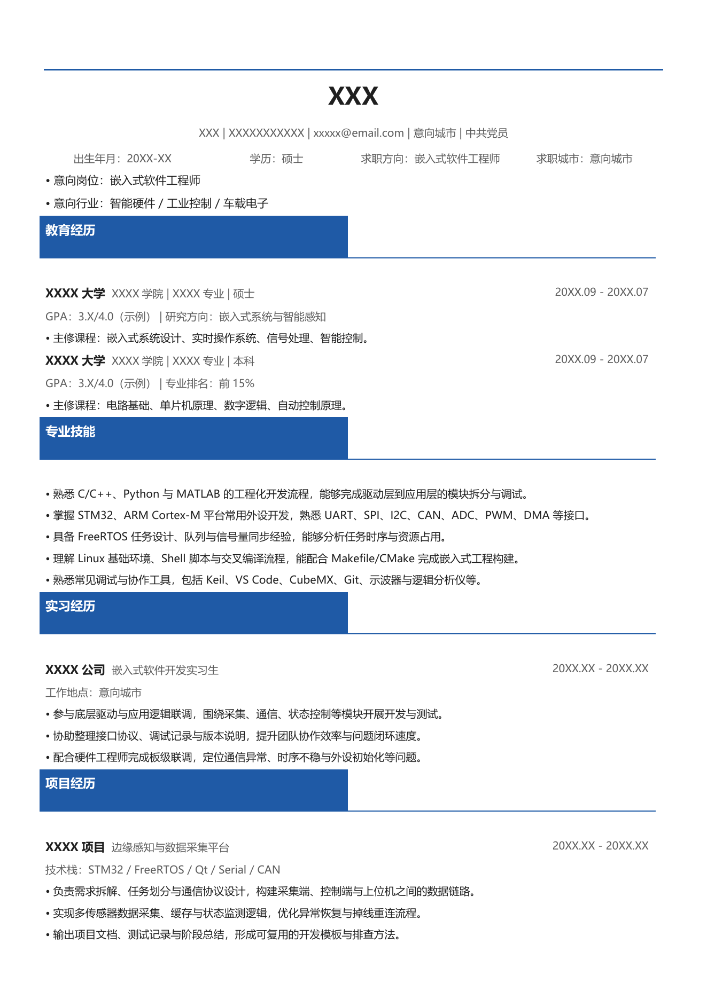
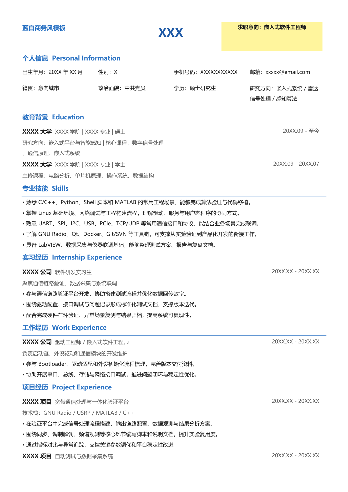
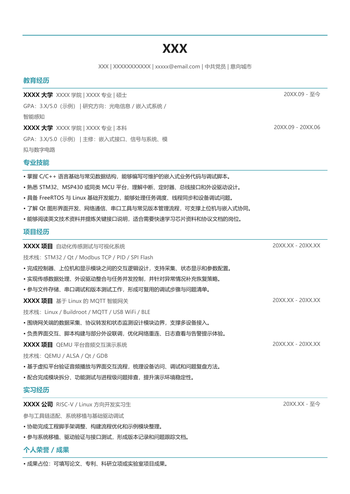
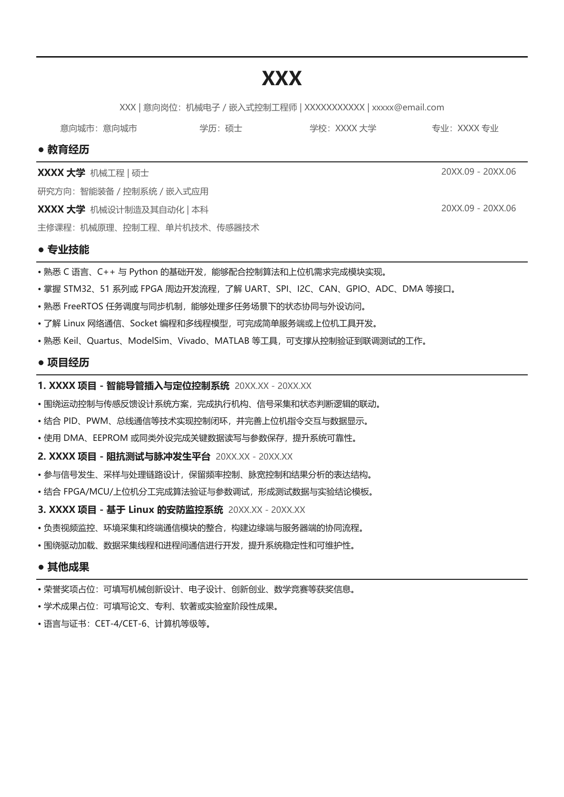
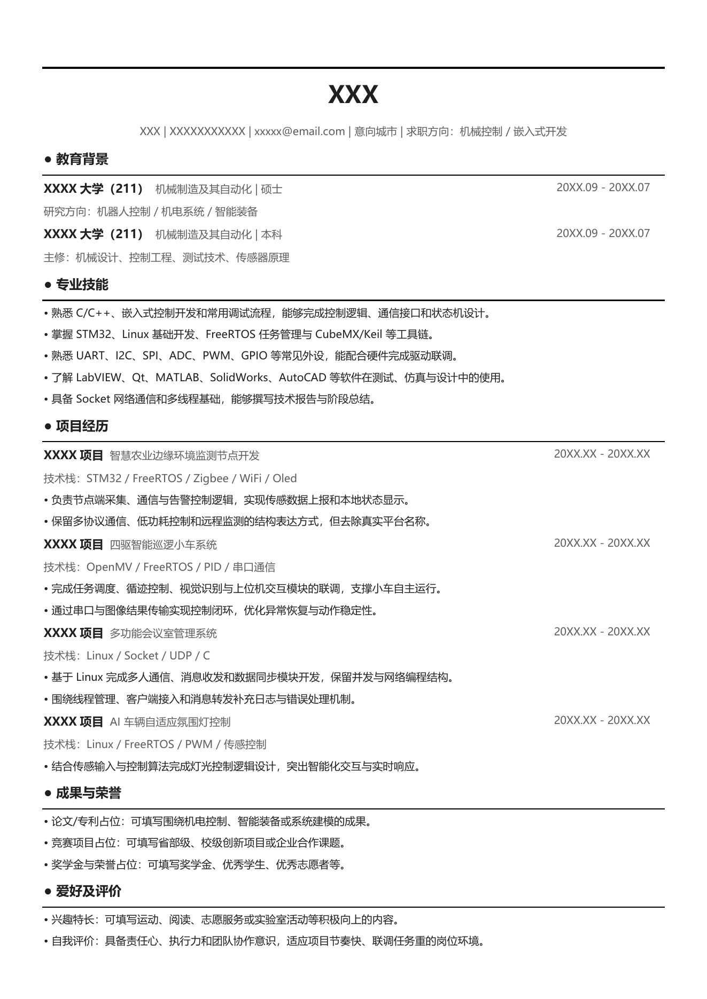
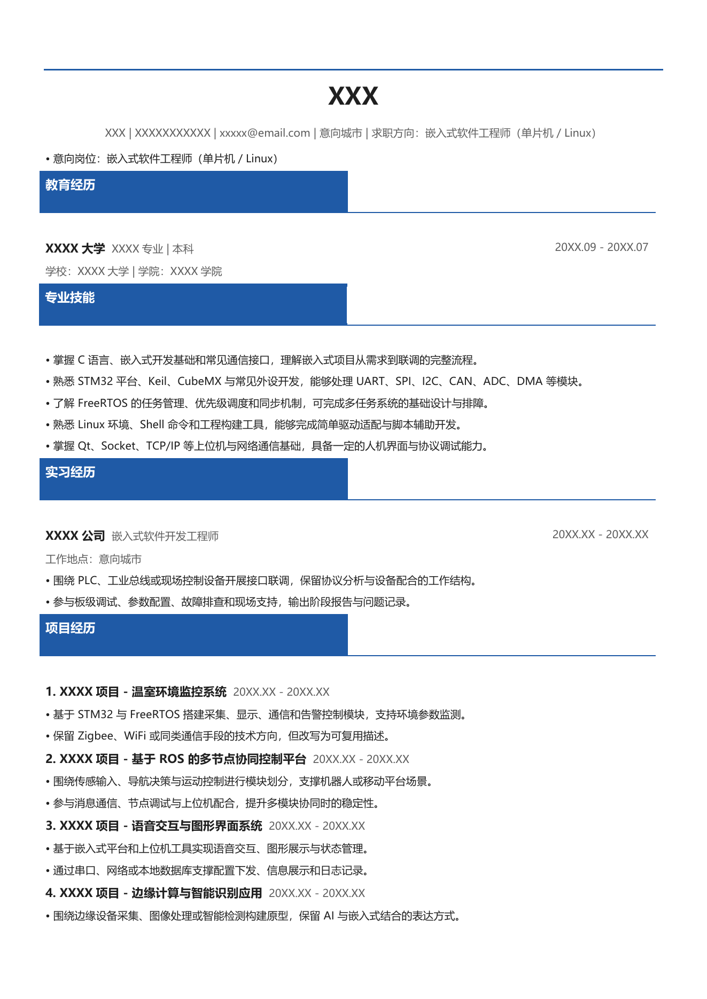
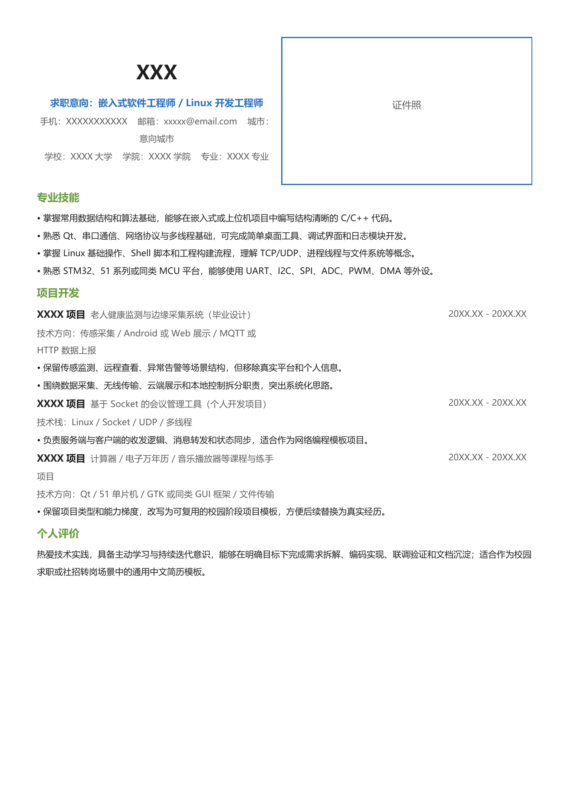

# GoodThings

持续整理和分享实用、可编辑的开源资源。后续会继续加入新的开源好物。

## 当前资源

### 中文简历模板

- 数量：7 份
- 格式：Microsoft Word（DOCX）
- 特点：中文排版、内容可编辑、可自行调整颜色和版式
- 适用方向：嵌入式、Linux、机械、自动化及相关技术岗位

## 模板预览与下载

| 模板 01 | 模板 02 |
| --- | --- |
|  |  |
| [下载模板 01](./resume-templates/resume_template_01.docx) | [下载模板 02](./resume-templates/resume_template_02.docx) |

| 模板 03 | 模板 04 |
| --- | --- |
|  |  |
| [下载模板 03](./resume-templates/resume_template_03.docx) | [下载模板 04](./resume-templates/resume_template_04.docx) |

| 模板 05 | 模板 06 |
| --- | --- |
|  |  |
| [下载模板 05](./resume-templates/resume_template_05.docx) | [下载模板 06](./resume-templates/resume_template_06.docx) |

| 模板 07 |
| --- |
|  |
| [下载模板 07](./resume-templates/resume_template_07.docx) |

## 使用提示

- 模板中的姓名、联系方式、学校、公司和项目内容均为占位示例，请完整替换后再使用。
- 推荐使用 Microsoft Word 编辑；使用 WPS Office、LibreOffice 等软件时，排版可能略有差异。
- 增删内容后请检查分页、对齐和行距，避免导出 PDF 时出现内容溢出。

## 后续更新

欢迎通过 Issue 提交建议或反馈问题。
